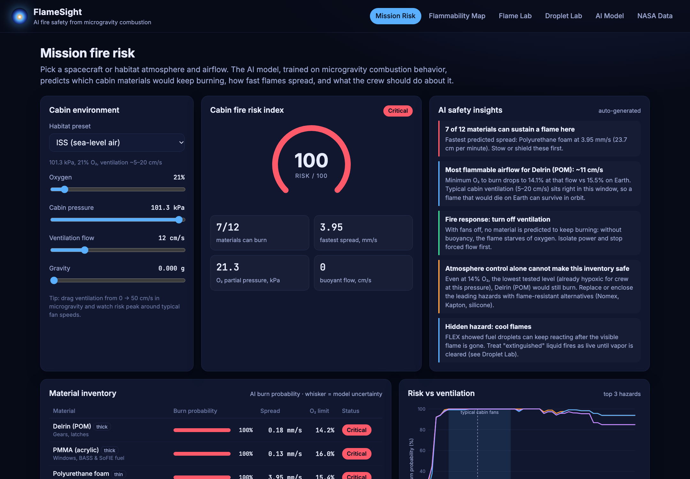
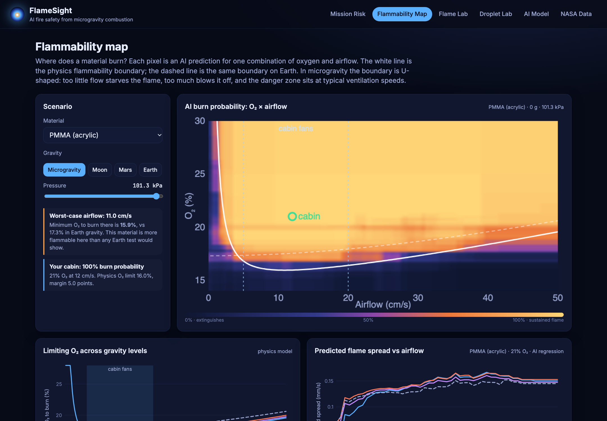
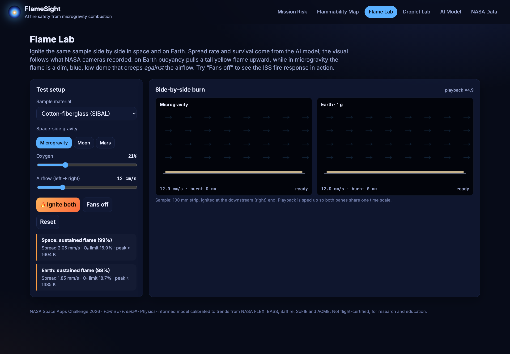
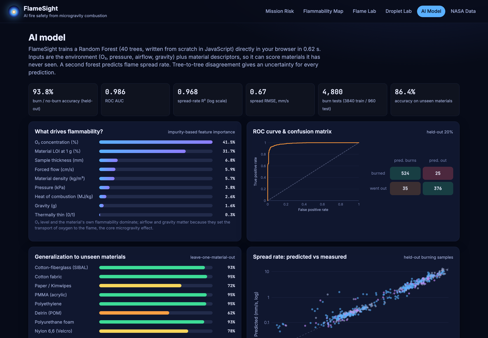

# 🔥 FlameSight: AI fire safety from microgravity combustion

**NASA Space Apps Challenge 2026 · _Flame in Freefall: AI-Powered Fire Safety Insights from Microgravity Combustion Data_**

**Live demo:** https://borgil0926.github.io/flamesight-microgravity-fire-ai/

FlameSight turns two decades of NASA microgravity combustion research (FLEX, BASS, Saffire, SoFIE, ACME) into a decision tool for spacecraft and habitat fire safety. A Random Forest that trains **in your browser in about a second** predicts whether a cabin material will keep burning, how fast the flame spreads, and how confident it is. It then explains what the crew or mission planner should do about it.



## The problem

Spacecraft materials are screened on Earth (NASA-STD-6001 Test 1, upward burning in 1 g). In orbit there is no buoyancy: flames are fed only by ventilation and diffusion. ISS experiments showed that:

- Solid-fuel flammability in microgravity is **U-shaped in airflow**. Flames starve at near-zero flow and blow off at high flow, and they are **most robust at a few to ~10 cm/s, the same range as cabin fans**. Some materials then burn at lower O₂ than any Earth test would show.
- **Partial gravity** (Moon 0.165 g, Mars 0.38 g) produces buoyant flows right in that worst-case window.
- **Exploration atmospheres** (e.g. 56.5 kPa / 34 % O₂ for Orion, Gateway and lunar habitats) make many "safe" materials flammable.
- **FLEX** found fuel droplets that keep reacting as invisible **cool flames** after the visible flame goes out.

There is no fire department in orbit. Crews need to know, ahead of time, which items are dangerous in *their* atmosphere and what action will actually put a fire out.

## What the app does

| Page | What you get |
|---|---|
| **Mission Risk** | Choose ISS, Orion/Gateway, Lunar, Mars or Apollo atmospheres (or set O₂, pressure, airflow and gravity yourself). You get a cabin fire-risk index, AI burn probability with an uncertainty whisker for 12 real cabin materials, predicted spread rates, a risk-vs-ventilation curve, and **auto-generated safety insights**: the worst-case airflow, whether shutting off fans will extinguish a fire, the O₂ level that makes the inventory safe, and where the model is unsure. |
| **Flammability Map** | AI heat map of burn probability over O₂ × airflow, drawn with the physics boundary in microgravity and on Earth. Limiting-O₂ curves for μg, Moon, Mars and Earth, plus predicted spread rate vs airflow. |
| **Flame Lab** | The same sample ignited side by side in space and on Earth. Spread rate and survival come from the model. Press **Fans off** to watch a microgravity flame starve (the first step of ISS fire response). It also flags "burns in space, not on Earth" cases. |
| **Droplet Lab (FLEX)** | d²-law droplet burning with radiative extinction, a **cool-flame phase** and diluent suppression (N₂, CO₂, He). Shows burn time, residual fuel and the hidden-hazard warning. |
| **AI Model** | Held-out accuracy, ROC/AUC, confusion matrix, spread-rate regression, feature importance, and **leave-one-material-out** generalization. You can also download the training CSV. |
| **NASA Data** | What each experiment found and how FlameSight uses it, with links to the NASA open data portals. |





## How the AI works

1. **Data.** 4,800 burn tests are generated from a reduced-order flammability model calibrated to trends reported by NASA microgravity experiments. They come from five "campaigns" that mirror real facilities: BASS-like (ISS glovebox), SoFIE-like (ISS Combustion Integrated Rack, 50–101 kPa, up to 40 % O₂), Saffire-like (large samples on Cygnus), partial-g parabolic flights, and 1 g NASA-STD-6001 tests. Measurement noise and stochastic burn outcomes near the limit are included.
2. **Features.** Environment (O₂ %, pressure, forced airflow, gravity, sample thickness) plus **material descriptors** (1 g limiting oxygen index, density, heat of combustion, thermally thin or thick). Because materials are described by properties rather than by name, the model can score materials it has never seen.
3. **Models.** Two Random Forests (40 trees each, histogram-split CART, written from scratch in `src/ml.js` with no ML library): a burn / no-burn classifier and a spread-rate regressor on log(1 + mm/s). Disagreement between trees gives a per-prediction uncertainty.
4. **Safety guardrail.** Outside the training envelope (e.g. Apollo's pure-O₂ cabin), the reported risk is never lower than the physics model. The app tells the user when this is happening.
5. **Insights.** `src/insights.js` sweeps the model over airflow, O₂ and fan-off scenarios and writes plain-language recommendations.

Typical results (deterministic seed): **~94 % held-out accuracy, AUC ≈ 0.986, spread R² ≈ 0.97**, and ~86 % accuracy on completely unseen materials.

### Honest limitations

- The bundled dataset is **physics-informed synthetic data**, not raw ISS measurements, so the app runs offline and reproducibly. The model shapes (U-shaped flammability, partial-g peak, exploration-atmosphere penalty, d² law, cool flames) follow published NASA findings, but the exact numbers are calibrated estimates.
- To train on real data, parse NASA PSI experiment data into rows with the columns shown in the CSV export (`material, o2, pressure, flow, gravity, thickness, burned, spread`) and pass them to `trainModels({ rows })`.
- This is not flight-certified. It is meant for research, education and early design trade studies.

## NASA data and research this builds on

- **FLEX / FLEX-2**: Flame Extinguishment Experiment (ISS Combustion Integrated Rack). Droplet combustion, diluent extinction, cool flames.
- **BASS / BASS-II**: Burning and Suppression of Solids (ISS Microgravity Science Glovebox). Flame spread over PMMA, fabrics and Delrin vs flow and O₂.
- **Saffire I–VI**: Spacecraft Fire Safety Experiment (Cygnus). First large-scale spacecraft fires.
- **SoFIE**: Solid Fuel Ignition and Extinction (ISS CIR). Ignition, growth and extinction limits incl. exploration atmospheres.
- **ACME**: Advanced Combustion via Microgravity Experiments (ISS CIR). Gaseous flames, soot, radiation.

Open data and papers: [NASA Physical Sciences Informatics](https://psi.nasa.gov) · [ISS Research Explorer](https://www.nasa.gov/mission/station/research-explorer/) · [NASA Technical Reports Server](https://ntrs.nasa.gov)

## Run it locally

```bash
npm install
npm run dev      # http://localhost:5173
npm test         # 16 unit tests (physics, ML, insights)
npm run build    # static site in dist/
```

No backend and no API keys. It is a static Vite site with zero runtime dependencies. Every push to `main` runs the tests and deploys to GitHub Pages (`.github/workflows/deploy.yml`).

## Project structure

```
src/
  physics.js     reduced-order flammability, spread, flame temperature, droplet (d², cool flame)
  data.js        materials, habitats, NASA experiment catalog, dataset generator
  ml.js          Random Forest + metrics (ROC/AUC, R², RMSE)
  model.js       training pipeline, prediction API, physics guardrail
  insights.js    natural-language safety recommendations
  charts.js      dependency-free SVG/canvas charts
  views/         Mission Risk, Flammability Map, Flame Lab, Droplet Lab, AI Model, NASA Data
tests/           Vitest suites
```

## License

MIT
